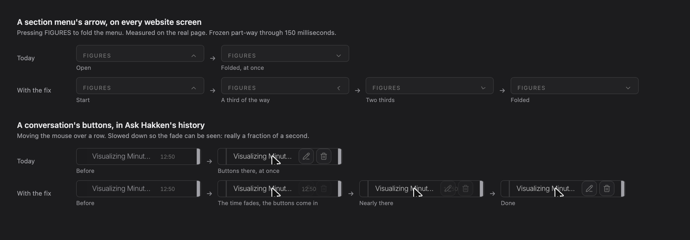

# Note: most of the movement in the app doesn't happen

**Written 2026-11-06, after Anthony said "Do this task here". He then said "ok do it": built the same day, as "What was built" says below. What follows above that is the note as it was written.**

## What's wrong

Across the app, about 107 places are written to move: an arrow turning, buttons fading in, a switch sliding. They don't. They jump straight to where they end.

The cause is one rule in `src/app/globals.css`, from the app's first commit on 28 March 2026. It eases colours when the theme changes, and it's written so that it outranks every movement class in the app. So those classes do nothing, and nothing fails to say so. A test that reads the class passes, which is how it went unseen until Live's bars jumped.

## What should move and doesn't

| What should happen | Places | Where you'd see it |
|---|---|---|
| Something fades in or out on hover | 59 | Ask Hakken's history, Tasks' rows, the app's main buttons, 39 in Admin |
| Something lifts or grows on hover | 21 | Ask Hakken's send and history buttons, Workflow boxes, the widget preview |
| An arrow turns | 17 | The section menus on every website screen, the website picker, Visibility's list, tabs' menus, folds in Settings, 10 in Admin |
| Something opens or switches | 4 | The switches in Settings, schedules, keep-for rules |
| A bar grows to its figure | 3 | Knowledge's and the Wiki's progress bars, Visibility's overview |
| A switch or small panel slides | 3 | The widget's greeting switch, the schema builder, a hover in Ask Hakken |
| **In all** | **107** | |

The other 135 lines with these classes lose nothing: 102 only change colour, which works today, and 33 have nothing that moves.

**These already move, and aren't touched:** the side menu, the eye's panel, pop-ups and drop-down menus, which use another tool, and the charts, which draw themselves in.

## The fix

Three small changes in `globals.css`, about 10 lines, and a test so it can't come back:

1. Put the theme's rule where the classes can outrank it (`@layer base`).
2. Keep movement at today's 300 milliseconds (`--default-transition-duration`), so colours on hover don't change speed.
3. One rule so it all stays still for anyone who asks for less motion. Today the app's `motion-reduce:` classes do nothing either.

## What I tried

All in your browser, on the live pages only, and put back each time. No code was changed.

- **All pages:** of 94 parts with a class, the 32 doing nothing all started working.
- **The arrow on FIGURES:** today it jumps. With the fix it turns over 150 milliseconds, measured part-way at 174 degrees.
- **Ask Hakken's history:** the time fades out as the edit and bin buttons fade in.
- **The speed setting:** colours stay at today's 0.3 seconds with it, and go to 0.15 without it.
- **Sitting still:** on All pages, the Admin dashboard and Visibility's list, nothing moved by itself over about 3 seconds a page.

## What else it changes

- **Places nobody has seen move will now move.** That's the point, and also the risk: some may feel wrong. A hover fade at 300 milliseconds might feel slow, for example. Each can be tuned.
- **No clashes found in the code.** No part uses both the other tool and one of these classes, and no `transition-all` line has a class that changes its size. Three lines animate a set style: one is a progress bar, which is what's wanted, and two only set a colour.
- **A part with only a fade or a slide class stops easing its colour.** That only shows on a theme change, which is rare.
- **No running cost.** Nothing more is read or asked of anyone.
- **Not checked:** the 107 places one by one, the public website, the widget, a phone, and how fast pages feel. I didn't time that.

## How long

About 1 day for a developer, or about 2 hours as agent work: the three changes and the test, then a look through the 107 places, tuning any that feel wrong, and the full checks. Nothing here needs Google, Convex or any real check that costs money.

## The one question

**Shall I fix it everywhere?**

Arrows would turn, switches would slide, and buttons would fade in on hover, across the app. Colours would stay as they are.

**I recommend yes.** It's a small change that brings back movement every screen was written to have, and it stops the same trap catching the next new part. If you'd rather not, nothing breaks: the app stays as you see it today, and new parts keep setting their own movement, as `docs/developer/screen-kit.md` now says.

Reply: "fix it everywhere" or "leave it".

## What was built

Anthony, 2026-11-06: "ok do it", after I'd said it was polish and could wait.

- **In `src/app/globals.css`:** the theme's rule is in `@layer base`, `--default-transition-duration` is 300 milliseconds, and nothing eases for anyone who asks for less motion.
- **`src/motion-classes-drift.test.ts`** fails a stylesheet that sets a transition on everything from outside a layer. A test can't see movement, so it holds the cause.
- **`docs/developer/screen-kit.md`** now says a class works, and to check movement in a real browser.
- **Live's bars keep their motion on the element,** as they worked already.

**Looked at in the signed-in app:**
- All pages: the arrow on FIGURES turns over 300 milliseconds, and colours stay at 0.3 seconds.
- The eye's panel on Live: each word fades in over 300 milliseconds and each sentence's colour eases over 500. That's what the teleprompter of 4 November was written to do, and it never ran.
- A switch on API keys: its knob slides over 300 milliseconds. Measured without pressing it, so nothing was saved.
- The side menu folds and unfolds as it did, with only its logo's fade added.
- Nothing moved by itself on Visibility's list, All pages or System Settings.
- Nothing set to move slower than 300 milliseconds on hover. The one slow class on a moving part is Knowledge's progress bar, at half a second, which is what's wanted.

**Not looked at one by one:** the 107 places, the public website, the widget and a phone. Colour-only and hover fades are the same code, but tell me if any feels wrong and I'll tune it.
